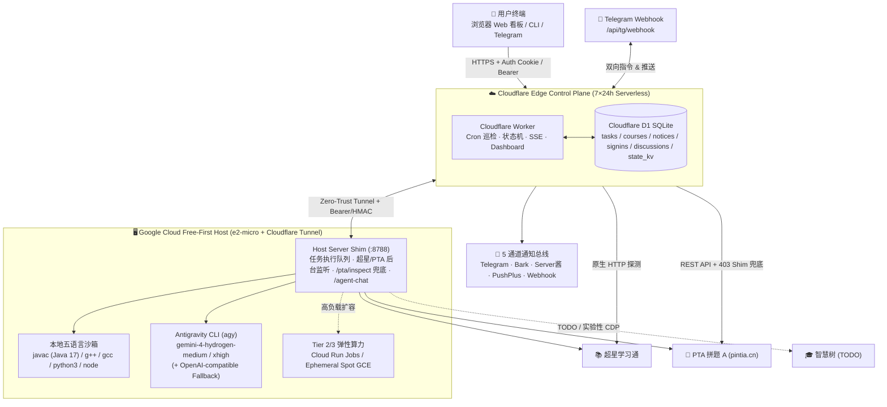

<div align="center">

# ☁️ afk-cloud (v1.1.0)

**Cloudflare Edge + Google Cloud Free-First Multi-Platform Autonomous Agent**

基于 **Cloudflare Workers + D1** 与 **GCP Free-First (`e2-micro` + Cloud Run Jobs)** 的多平台个人云端自治 Agent。  
原生集成 **超星学习通** 与 **PTA 拼题 A** 双生产级协议插件、本地 **五语言编程评测沙箱**、**Antigravity (`agy`)** 深度求解引擎、**Telegram 双向远程控制** 以及 **6 标签暗夜毛玻璃 Web 控制台**。


</div>

---

## 🌟 核心特性一览

- **🧩 插件化多平台统一架构 (`Chaoxing` × `PTA` × `Zhihuishu [TODO]`)**
  - **超星学习通 (`chaoxing` v1.2.0)**：原生协议适配器，覆盖多类型签到、课程公告同步、全部课程章节任务点进度追踪 (`/api/courses/progress`)、课件批量拉取与 RAG 上下文构建、作业/重开测验识别与双轨求解、讨论区抓帖 + 课件 RAG 拟稿与审批发布。
  - **PTA 拼题 A (`pta` v1.1.0)**：直连 `pintia.cn/api`，支持 **7 类题型**（编程题、单选、多选、判断、填空、程序填空、主观题）、远程题库实时监听与上新同步、**五语言本地沙箱编译对拍**、PTA 官方判题轮询、以及 **防 `OVERRIDDEN` 整卷答案合并提交**（默认仅保存提交题解，绝不越权调用 `/end` 提前交卷）。
- **🖥️ 双面协同控制面 (Cloudflare Edge + Host Shim)**
  - Cloudflare Workers 7×24h Cron 自主巡检任务、通知与登录态，并在遇到源站对数据中心 IP 的 `403` 拦截时（如 PTA Cloudflare 风控）自动桥接宿主机 Shim (`POST /pta/inspect`) 完成兜底探测。
  - 提供 **6 标签实时暗夜毛玻璃监控看板**（作业与实验任务、话题讨论、考试与随堂测验、自动签到记录、在读课程概况、通知通道与架构）。
- **🤖 Telegram 双向指挥中心 + 5 通道 4 层防重告警**
  - 原生接入 Telegram Webhook (`/api/tg/webhook`) 与宿主机对话网关 (`/agent-chat`)：随时查状态、刷作业、强刷 PTA / 超星章节进度、维护个人待办，甚至直接用自然语言向本地 `agy` 下发任务。
  - 支持 **Telegram、Bark、Server酱、PushPlus、通用 Webhook (Discord/飞书/钉钉)** 五通道并发推送，内置 4 层防重去重冷却与 UTC+8 听课窗口管理。
- **🛡️ 安全优先与零预算友好的三层算力漏斗**
  - **Tier 1 (`$0.00`)**：宿主机 `e2-micro` 本地五语言编译沙箱 (`javac` Java 17 / `g++` / `gcc` / `python3` / `node`) + Antigravity CLI (`agy`) 求解。
  - **Tier 2 (`$0.00` 免费额度)**：Google Cloud Run Jobs 无服务器容器批处理与 Cloudflare Edge Workers。
  - **Tier 3 (`~$0.001 / 次`)**：按需拉起临时 `e2-micro` Spot GCE 节点执行高负载作业并带 TTL 自动销毁。

---

## 🏗️ 全局系统架构



---

## 🧩 平台插件体系与真实能力边界

通过 `pnpm afk plugins` 可随时检视已注册插件与能力标签：

| 插件 ID | 名称与版本 | 状态 | 核心能力 | 实现与策略说明 |
| :--- | :--- | :--- | :--- | :--- |
| **`chaoxing`** | 超星学习通自适应插件 (`v1.2.0`) | ✅ **已投产** | `courses`, `materials`, `homework`, `signin`, `discussions` | 原生 HTTP 会话与登录态缓存；支持课程列表、课程公告、全课程章节任务点进度抓取、课件 RAG 资料下载、多类型签到（普通/二维码/位置/手势/拍照）与自适应退避、讨论区拟稿审批及作业/重开测验安全草稿暂存 |
| **`pta`** | PTA 拼题 A 编程评测与监听插件 (`v1.1.0`) | ✅ **已投产** | `courses`, `homework`, `sandbox` | 直连 `pintia.cn/api` 题目集/题目/提交历史；支持 Edge + Shim 7×24h 活跃题目集自动发现、本地 5 语言沙箱对拍 + 远程判题轮询、7 种题型统一作答与 **防 `OVERRIDDEN` 全量答案合并暂存**；内置 `PTASession` `HttpOnly` 完整度拦截校验 |
| **`zhihuishu`** | 智慧树 / 知到合规播放插件 (`v1.1.0`) | 🚧 **TODO / 实验性** | `courses`, `homework`, `browser-cdp` | 仅保留新版 `studyvideoh5.zhihuishu.com/stuStudy` 的 Playwright CDP 合规倍速播放代码骨架；因网易易盾滑块验证码与高内存浏览器在 `e2-micro`（1GB RAM）上的限制，暂未投入无人值守运行 |

---

## 🧪 三层算力漏斗与安全提交机制

1. **五语言本地免费沙箱 (`packages/core/sandbox.ts`)**：
   - 自动识别或按 `language` 指定 `cpp` (`g++`)、`c` (`gcc`)、`python` (`python3`)、`java` (`javac` + `java`, 自动提取 `public class` 名)、`javascript` (`node`)。
   - 在提交或调用高阶模型前，先在本地隔离临时目录完成语法解析/编译与标准输入输出样例对拍，仅当编译与用例通过（或显式强制校验）时才推进流程。
2. **双模型路由与降级链 (`packages/core/solver.ts`)**：
   - 支持本地 Antigravity CLI (`agy`) 调度 `gemini-4-hydrogen-medium` / `gemini-4-hydrogen-xhigh`，以及兼容 OpenAI 接口的模型兜底（如 DeepSeek API）。
   - 解析/模型层异常时自动记录诊断并在 D1 `tasks` 中留痕，不会覆盖已有高分答案或盲目交卷。
3. **默认草稿暂存与 PTA 防覆盖提交**：
   - **超星作业/测验**：默认 `CHAOXING_AUTO_SUBMIT=false`，将求解结果写入超星安全草稿，由用户在看板一键确认或命令行指定 `--auto-submit` 才提交；且对独立考试类任务额外设置人工确认护栏 (`homework-reopen-and-exam-guard`)。
   - **PTA 题目集**：提交前读取服务端已有 `last-submissions` / `problem-set-exams`，将新答案与旧答案按题号/类型整合并集后提交，避免触发 PTA `OVERRIDDEN` 状态，且全程 **不调用** `/end` 结束作答接口。

---

## 💬 Telegram Bot 远程指令集

配置 `TELEGRAM_BOT_TOKEN`、`TELEGRAM_CHAT_ID` 与 Webhook（`/api/tg/webhook`，建议配合 `TELEGRAM_WEBHOOK_SECRET`）后，即可直接在 Telegram 中双向操控 Edge 与宿主机 `agy`：

| 指令 / 触发词 | 别名 | 执行平面 | 功能说明 |
| :--- | :--- | :--- | :--- |
| `/start` / `/help` | — | Cloudflare Edge | 查看机器人状态与常用指令菜单 |
| `/status` | `状态` | Cloudflare Edge | 查询 D1 中在读课程数、任务数、签到累计、题库缓存及 Shim 配置状态 |
| `/tasks` | `作业` | Cloudflare Edge | 按超星 / PTA 分组列出最近待办作业、草稿与完成状态 |
| `/progress` | `进度` | Cloudflare Edge | 读取 D1 已缓存的超星全部课程章节任务点进度汇总 |
| `/progress!` | `刷新进度` | Shim (`POST /agent-chat`) | 实时登录超星抓取全部在读课程最新章节完成率并同步回写 D1 |
| `/pta` / `/pta!` | `刷新PTA` | Shim (`POST /agent-chat`) | 实时扫描 `pintia.cn` 活跃题目集与作答状态，同步 D1 并返回明细 |
| `/todos` | `待办` | Shim (`POST /agent-chat`) | 查看本地轻量个人待办清单 |
| `/todo <内容>` | — | Shim (`POST /agent-chat`) | 新增一条个人待办事项 |
| `/done <关键词或序号>` | — | Shim (`POST /agent-chat`) | 勾选完成并归档对应个人待办 |
| `/news` | `资讯` | Shim (`POST /agent-chat`) | 拉取并展示超星课程公告与近期通知摘要 |
| `/activity` | `日志` | Shim (`POST /agent-chat`) | 查看 Shim 最近调度执行与事件日志 |
| `/evolve` | — | Shim (`POST /agent-chat`) | 查看当前引擎演进与宿主机巡检健康状态 |
| *任意自然语言消息* | — | Shim -> `agy` | 异步投递至宿主机 Antigravity CLI (`agy`) 自主处理并回传结果 |

---

## 🔔 五通道通知与 4 层防重去重机制

- **5 通道并行通知总线 (`edge/src/notify.ts`)**：支持 **Telegram Bot、Bark、Server酱、PushPlus、Webhook**。
- **4 层防漏推防重复机制**：
  1. **冷却与单次失败去重**：超星 `mobilelearn` 若遭遇机房 IP 封禁，写入 `blockedCooldownUntilMs` 触发 **12 小时告警冷却**；同一 `activeId` 签到失败仅首次告警；PTA 检查与新题目集推送内置 12 小时/指纹去重，避免周期轮询刷屏。
  2. **D1 分布式防重锁 (`LOCK:<key>`)**：通过 Cloudflare D1 原子状态锁拦截 Cron 与手动请求并发造成的重复推送。
  3. **摘要指纹状态差对比 (`last_summary`)**：全量汇总仅在任务指纹真正变化时触发简报，无变动零打扰。
  4. **公告溢出合并 + UTC+8 窗口控制**：新公告超过 5 条时逐条推送前 5 条并自动合并推送剩余汇总 (`notice_overflow_batch`)；高频率签到监听支持通过 `SIGN_LISTEN_WINDOWS`（默认 `08:15-11:40,13:00-16:20,18:00-19:35`）精确限定于北京时间授课时段。

---

## 🚀 快速开始与部署

### 1. 环境准备

- **本地 / 宿主机依赖**：Node.js >= 20、`pnpm`
- **沙箱编译器按需安装**（用于 C/C++/Python/Java/JS 本地编程题验证）：
  - Java 17+: `javac` & `java`
  - C/C++: `gcc` / `g++`
  - Python 3: `python3`
- **Antigravity CLI**：已在宿主机配置好 `agy`（或配置 `AFK_SOLVER_PROVIDER=openai` 与 `OPENAI_API_KEY` 作为备选模型后端）

```bash
git clone https://github.com/YOUR_USERNAME/afk-cloud.git
cd afk-cloud
pnpm install
cp .env.example .env
cp edge/wrangler.jsonc.example edge/wrangler.jsonc
```

### 2. 配置环境变量

编辑 `.env`（已被 `.gitignore` 严格忽略，**切勿提交到仓库**）。核心变量分类如下（完整模板见 [.env.example](./.env.example)）：

- **超星 / PTA 登录与策略**：
  - `CHAOXING_PHONE`、`CHAOXING_PASSWORD`、`CHAOXING_REALNAME`、`CHAOXING_FID`、`CHAOXING_AUTO_SUBMIT`
  - `CHAOXING_SIGN_LON`、`CHAOXING_SIGN_LAT`、`CHAOXING_SIGN_ADDRESS`（位置签到参数）
  - `PTA_SESSION_COOKIE`（含 `HttpOnly` 的完整 Cookie 串，亦支持写入 D1 会话表）
  - `HOMEWORK_SCAN_INTERVAL_MINUTES`（默认 `10`）、`SIGN_LISTEN_WINDOWS`、`AUTO_PUBLISH_DISCUSSIONS`（默认 `false`）
  - `PTA_WATCH_ENABLED`（默认 `true`）、`PTA_WATCH_INTERVAL_MINUTES`（默认 `10`）
- **AI 求解路由**：
  - `AFK_SOLVER_PROVIDER`（默认 `agy`）、`AFK_FLASH_MODEL`（`gemini-4-hydrogen-medium`）、`AFK_PRO_MODEL`（`gemini-4-hydrogen-xhigh`）
  - 备选 OpenAI 兼容接口：`OPENAI_API_KEY`、`OPENAI_BASE_URL`
- **Cloudflare Edge & Shim 安全连接**：
  - `CLOUDFLARE_ACCOUNT_ID`、`CLOUDFLARE_API_TOKEN`、`AFK_EDGE_WORKER_URL`
  - `AFK_EDGE_BEARER_TOKEN`、`DASHBOARD_PASSWORD`、`AFK_SHIM_SECRET`、`AFK_SHIM_URL`
  - `AFK_TASK_HOST_ALLOWLIST`（默认 `chaoxing.com,zhihuishu.com,pintia.cn`，Fail-Closed SSRF 域白名单）
- **GCP Infra 与弹性算力**：
  - `GCP_PROJECT_ID`、`GCP_REGION`、`GCP_ZONE`、`GCP_SERVICE_ACCOUNT`
  - `CLOUD_RUN_JOB_NAME`、`GCE_BURST_MACHINE_TYPE`（`e2-micro`）、`GCE_BURST_TTL_MINUTES`、`GCE_BURST_USE_SPOT`
- **通知与 Telegram Bot**：
  - `TELEGRAM_BOT_TOKEN`、`TELEGRAM_CHAT_ID`、`TELEGRAM_WEBHOOK_SECRET`
  - `WEBHOOK_URL`、`SERVERCHAN_KEY`、`PUSHPLUS_TOKEN`、`BARK_KEY`

### 3. 一键自动化基础设施编排

项目提供端到端 CLI 与 `infra/gcp/*.sh` 脚本（支持 `--dry-run` 预演）：

```bash
# 查看全量编排预演（Cloudflare D1 + Worker + GCP VM + Cloud Run Jobs + IAM 护栏）
pnpm afk setup-all --dry-run

# 执行 Cloudflare Edge 迁移与 Worker 部署
pnpm afk:setup-cf
# 或使用底层 workspace 命令
pnpm edge:migrate:remote
pnpm edge:deploy

# 执行 GCP 底座与弹性算力配置
pnpm afk:setup-gcp
```

`infra/gcp/` 运维脚本清单（共 7 个，均纳入 CI `bash -n` 静态检查）：
- `bootstrap-gcp-node.sh`：初始化 Ubuntu/Debian 云主机与 Node/pnpm/浏览器/沙箱运行环境
- `provision-free-vm.sh`：创建 GCP Always-Free `e2-micro` VM
- `run-shim-tunnel.sh`：配置 Cloudflare Tunnel + Host Shim (`systemd`) 常驻守护
- `setup-iam-guardrails.sh`：配置最小权限服务账号与安全护栏
- `deploy-cloud-run-job.sh` / `deploy-cloud-run-service.sh`：部署 Tier 2 Cloud Run 批处理与常驻服务
- `spawn-ephemeral-gce.sh`：拉起带 TTL 自毁的临时 Spot GCE 突发节点

### 4. 导入 PTA Cookie 与启动宿主机 Shim

由于 `PTASession` 带有 `HttpOnly` 标记（详见下方注意事项），请从浏览器开发者工具请求头/Application 中复制完整 Cookie 导入持久化 Profile 并推送云端：

```bash
# 导入 PTA 完整 Cookie 并自动推云同步到 D1
pnpm afk profile import-cookie --platform pta --cookie "PTASession=...; JSESSIONID=..."

# 检查环境、登录态与 Cloudflare Edge 健康状态 (/health)
pnpm afk:status

# 启动宿主机 Shim（含超星周期巡检、PTA 监听、agy 执行器与 Telegram agent-chat 网桥）
pnpm shim
```

---

## 💻 CLI 命令速查手册

基础入口：`pnpm afk <command> [options]`（支持 `pnpm afk help` / `--help` / `-h`）

| 命令 / 快捷脚本 | 常用参数 | 功能说明 |
| :--- | :--- | :--- |
| `status` (`pnpm afk:status`) | — | 环境自检、本地 Profile/登录态及 Edge `/health` 探测 |
| `plugins` / `skills` | — | 查看已注册平台插件、版本号与能力矩阵 |
| `scan` (`pnpm afk:scan`) | `--platform chaoxing\|pta\|all` `--progress` | 扫描超星在读课程与待办作业，或扫描 PTA 活跃题目集 |
| `progress` / `chapters` (`pnpm afk:progress`) | — | 扫描超星全部课程章节任务点完成进度并同步至 D1 看板 |
| `solve` (`pnpm afk:solve`) | `--platform chaoxing\|pta\|all` `--auto-submit` `--tier local\|cloud-run\|gce` | 双轨求解待办作业（默认安全草稿暂存） |
| `pta` (`pnpm afk:pta`) | `scan \| solve \| watch` `--id <psId>` `--auto-submit` `--interval <min>` | PTA 拼题 A 专项扫描、本地沙箱求解暂存与后台监听 |
| `discuss` (`pnpm afk:discuss`) | `--auto-submit` | 抓取超星讨论区话题、结合课件 RAG 拟稿及审批/发布 |
| `materials` / `download` (`pnpm afk:materials`) | — | 批量下载超星课程资料构建本地 RAG 上下文 |
| `signin` (`pnpm afk:signin`) | — | 手动触发一次超星全课程活动签到巡检 |
| `poll` (`pnpm afk:poll`) | `--loop` `--interval <min>` | 拉取 D1 待执行队列，并同步巡检超星与 PTA |
| `profile` | `<status\|import-cookie\|push\|pull>` `--platform pta\|zhihuishu` `--cookie "..."` | 管理本地持久化 Profile 登录态及与 D1 的加密/安全同步 |
| `web` | `--platform pta\|zhihuishu` | 启动挂载持久化 Profile 的 CDP 浏览器实例（配合人工登录导出状态） |
| `notify` / `digest` | — | 手动触发一次全平台汇总简报推送 |
| `shim` (`pnpm shim`) | `--host 127.0.0.1` `--port 8788` | 启动宿主机 Server Shim |
| `setup-cf` / `setup-vm` / `setup-gcp` / `setup-all` | `--dry-run` | 自动化编排 Cloudflare 边缘层（Workers + 5 份 D1 SQL 迁移）与 GCP 基础设施 |
| `burst` | `--mode cloud-run\|gce` | 手动触发 Tier 2/3 弹性算力扩容任务 |
| `zhihuishu` / `zhs` / `watch` | — | `[TODO / 实验性]` 智慧树合规真实播放守护 |

---

## 🧪 CI/CD 与质量覆盖率门禁

`.github/workflows/ci.yml` 与本地 `pnpm typecheck && pnpm test` 共同覆盖以下门禁：

- **全仓严格类型检查 (`pnpm typecheck`)**：同时检查主工程与 `edge/tsconfig.json` Cloudflare Workers 类型约束。
- **CLI 与插件契约冒烟**：校验 `cli --help`、`cli plugins` 同时输出 `[chaoxing]`、`[pta]`、`[zhihuishu]`，以及 `setup-cf --dry-run`、`setup-gcp --dry-run`。
- **11 个全量自动化测试套件 (`pnpm test`)**：
  1. `tests/smoke.test.ts`：核心模块与协议适配器基础冒烟
  2. `tests/ratelimit-backoff.test.ts`：速率限制、指数退避与冷却状态机
  3. `tests/signin-and-submitting.test.ts`：多类型签到解析与安全提交护栏
  4. `tests/discussion-idempotency.test.ts`：讨论区发帖幂等性、拟稿与审批隔离
  5. `tests/failed-task-retry.test.ts`：失败任务重试与状态机流转
  6. `tests/solver-cache-guard.test.ts`：题库缓存隔离、高分防护与安全重用
  7. `tests/security-hardening.test.ts`：加密签名、鉴权中间件与凭证脱敏护栏
  8. `tests/homework-reopen-and-exam-guard.test.ts`：重开/打回作业识别与独立考试人工护栏
  9. `tests/zhihuishu-plugin.test.ts`：智慧树插件注册、CDP 骨架状态与内存防护
  10. `tests/pta-plugin.test.ts`：PTA 7 题型解析、防 `OVERRIDDEN` 合并（零 `/end`）、Java 17/多语言沙箱对拍与 Edge/Shim 监听去重及 `403` 兜底降级
  11. `tests/ci-and-edge-coverage.test.ts`：Edge Fail-Closed 鉴权与 SSRF 白名单、5 通道通知并发、超 5 条通知溢出合并、`mobilelearn` 12h 封禁冷却、`SIGN_LISTEN_WINDOWS`、以及“所有 `tests/*.test.ts` 必须纳管于 `package.json`”完整性校验
- **Edge Dry-Run 打包、SQL 幂等与防泄漏检查**：校验 `wrangler deploy --dry-run`（CI 临时模板注入）、D1 迁移文件 `0001`–`0005` 的 `IF NOT EXISTS` 幂等性、`infra/gcp/*.sh` 全量 `bash -n`，以及 `.env` / `wrangler.jsonc` / 硬编码秘钥扫描。

---

## ⚠️ 注意事项与安全护栏 (Caveats)

- **超星机房 IP 风控**：`mobilelearn.chaoxing.com` 对海外云机房 IP（包括 Cloudflare Edge 节点与海外 GCP VM）存在较严格风控，若触发封禁会进入 **12 小时告警冷却** 并在 Dashboard 展示受限提示，此时建议配合宿主机本土代理或等待自动冷却。
- **PTA Cookie 的 `PTASession` 为 `HttpOnly`**：在浏览器 Console 中执行 `document.cookie` **无法** 读出 `PTASession`。请务必在登录 `pintia.cn` 后通过开发者工具 `Application -> Cookies` 或 `Network` 请求头复制包含 `PTASession=...` 的完整 Cookie 字符串，交由 `pnpm afk profile import-cookie --platform pta --cookie "..."` 导入；代码内已增加 `HttpOnly` 缺失拦截保护，防止不完整 Cookie 覆盖云端有效会话。
- **PTA 安全提交原则**：系统默认且强制禁止在无人确认下自动调用结束考试 `/end` 接口，并始终合并服务端已提交答案以防止 `OVERRIDDEN` 覆盖误伤。
- **智慧树 (`zhihuishu`) 当前属于实验性 TODO**：因网易易盾滑块验证机制与无头 Chromium 浏览器在 `e2-micro`（1GB RAM + 2GB Swap）上的内存消耗，暂不建议在无人工干预的 24/7 云端生产环境中开启无人托管。
- **时区与跨进程锁**：`SIGN_LISTEN_WINDOWS` 固定基于 **UTC+8**（北京时间）判定，运行并行任务或单元测试时需依赖 `AFK_LOCK_FILE` 文件锁保证单实例互斥。

---

## 🗺️ Roadmap / TODO

- [ ] **智慧树 (`zhihuishu`) 插件生产化**：完善网易易盾验证码检测与 Telegram 人工接管回传闭环，优化无头浏览器内存占用或支持远程轻量浏览器节点。
- [ ] **超星 `mobilelearn` 代理池与 WebIM 常驻**：支持国内住宅代理按课程/签到路由配置，探索 WebIM 实时长连接捕获以实现秒级签到触发。
- [ ] **Telegram Inline Keyboard 交互按钮**：为待审批讨论拟稿、安全草稿作业与异常告警增加 Telegram 行内确认按钮（一键发布草稿 / 一键重试 / 一键忽略）。
- [ ] **容器化多账号发行版**：提供标准 Docker / DevContainer 一键部署镜像，便于社区开发者零门槛私有化托管。

---

<div align="center">

Made with ☁️ **Cloudflare Workers + D1** · 🤖 **Google Antigravity CLI (`agy`)** · 🐧 **GCP Always-Free `e2-micro`**

</div>
